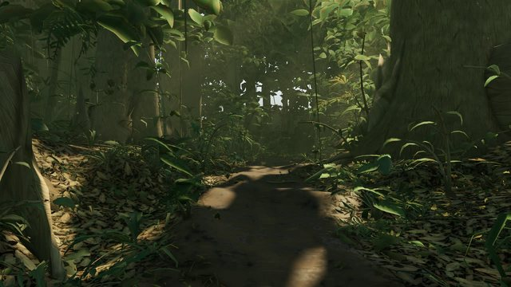
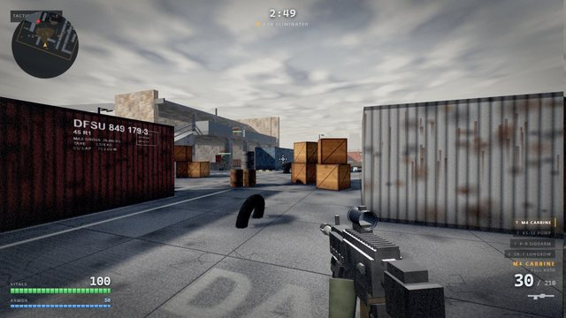
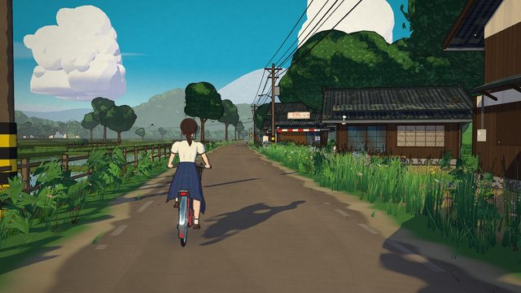

<picture>
  <source media="(prefers-color-scheme: dark)" srcset="assets/terminal-dark.svg">
  <source media="(prefers-color-scheme: light)" srcset="assets/terminal-light.svg">
  
</picture>

<!-- BUILDS:START -->
<table>
<tr>
<td width="33%" valign="top"> <a href="https://github.com/StarKnightt/jungle-trail"><b>jungle-trail</b></a> ★ 307</td>
<td width="33%" valign="top"> <a href="https://github.com/StarKnightt/night-street"><b>night-street</b></a> ★ 133</td>
<td width="33%" valign="top"> <a href="https://github.com/StarKnightt/operation-ironhold"><b>operation-ironhold</b></a> ★ 107</td>
</tr>
<tr>
<td width="33%" valign="top"> <a href="https://github.com/StarKnightt/summer-cycle"><b>summer-cycle</b></a> ★ 70</td>
<td width="33%" valign="top"> <a href="https://github.com/StarKnightt/bay-ride"><b>bay-ride</b></a> ★ 50</td>
<td width="33%" valign="top"> <a href="https://github.com/StarKnightt/sedona-sunset"><b>sedona-sunset</b></a> ★ 41</td>
</tr>
</table>
<!-- BUILDS:END -->

  &nbsp;&nbsp;
  

<a href="https://prasen.dev">prasen.dev</a> · <a href="https://x.com/prasenx">x.com/prasenx</a>

